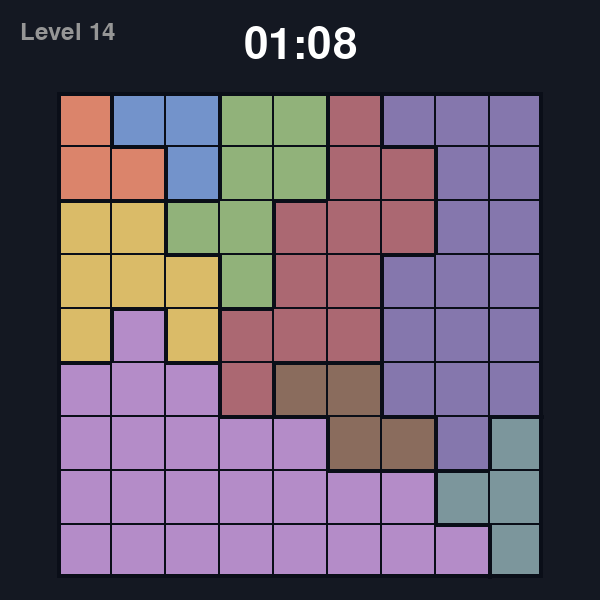
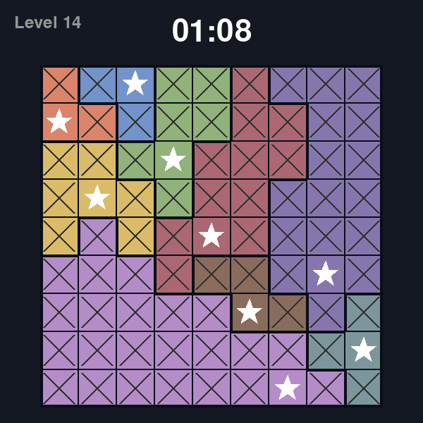

# Starstruck (Star Battle) Python Clone 🌟

A complete, procedurally generated clone of the logic puzzle game "Starstruck" (also known as Star Battle), built from scratch using Python and Pygame. 

This project features a custom game engine, a Depth-First Search (DFS) backtracking solver for mathematical uniqueness, and a multi-core batch generator to conquer the combinatorial explosion of complex graph topologies in larger grids.

<p align="center">
  
  
</p>

##  Features

* **Hybrid Procedural Generation:** Uses blazing-fast randomized Breadth-First Search (BFS) for 8x8 Live Mode, and a solver-guided reverse mutation algorithm for 9x9+ grids to systematically carve regions and destroy competing solutions.
* **Deterministic Solver Engine:** Implements recursive DFS with aggressive tree-pruning to guarantee every generated puzzle has exactly *one* valid solution.
* **Multi-Core Batch Generation:** Leverages Python's `ProcessPoolExecutor` to distribute the computational load of Hard Mode generation across all available CPU threads, serializing valid puzzles to dedicated JSON databases.
* **Interactive UI & Animations:** Features dynamic window resizing, a retro CRT phosphor shader, translucent state-machine overlays, and a distance-based cascading animation queue for auto-marking invalid cells.
* **Procedural DSP Audio:** Utilizes NumPy to synthesize real-time, low-latency oscillators (sine, square) and ADSR envelopes for tactile UI sound effects directly into Pygame's mixer.
* **Progression System:** Reads from local JSON databases to provide a paginated level-select screen, tracking and visually updating completed puzzles.
* **State Exporter:** Built-in tool to instantly export pristine `.png` images of both the initial and solved states of any puzzle.

##  Installation & Setup

1. **Clone the repository:**
   ```bash
   git clone [https://github.com/GutoC7/Starstruck.git](https://github.com/GutoC7/Starstruck.git)
   cd Starstruck

```


2. **Install dependencies:**
This project requires Python 3.12+ and Pygame.
```bash
pip install pygame

```


3. **Run the game:**
```bash
python src/main.py

```


##  Controls

* **Left Click:** Cycle cell state (Empty → Mark '×' → Star '★')
* **Left/Right Click & Drag:** Paint empty cells as impossible ('×') without overwriting stars
* **ESC:** Pause Game / Return to Menu
* **1-4 / Numpad:** Menu Navigation & Level Selection
* **H:** Use an O(1) Hint to correct a mistake or reveal a star
* **Ctrl+Z:** Undo last action
* **C:** Toggle CRT retro visual filter


##  Architecture

The codebase is strictly decoupled to separate the mathematical logic from the visual rendering:

```text
src/
├── core/
│   ├── engine.py           # Manages matrix state, O(1) conflict tracking, and action stacks
│   ├── generator.py        # Hybrid region growth (BFS and Solver-guided border carving)
│   ├── solver.py           # DFS Backtracking uniqueness validator
│   └── audio.py            # Real-time procedural DSP audio synthesis (NumPy)
├── puzzles.json            # Database of pre-calculated, verified Hard levels (9x9)
├── expert_puzzles.json     # Database of pre-calculated, verified Expert levels (12x12)
├── batch_generate.py       # Multi-threaded offline generator script
├── ui.py                   # Pygame rendering, scaling, and state machine
└── main.py                 # Application entry point

```

##  Generating Hard Mode Puzzles

Because 9x9 grids require strict topological constraints to ensure a unique solution, the engine must actively carve borders to eliminate ambiguity. To prevent the main thread from blocking during this intensive topological calculation, Hard and Expert puzzles are generated offline.

To generate a new batch of puzzles using all your CPU cores:

```bash
python src/batch_generate.py

```
Performance Note: Historically, brute-forcing unique 9x9 grids took ~2 hours for 20 puzzles on an i7-10700F. With the newly implemented solver-guided reverse mutation algorithm, generation time has been reduced to ~30 seconds for 10 levels.

(Note: Levels 1-77 in `puzzles.json` were generated using the legacy combinatorial BFS algorithm and showcase classic survivorship bias patterns. Levels 78-150+ leverage the modern solver-guided approach for globally entangled, pattern-free layouts.)

